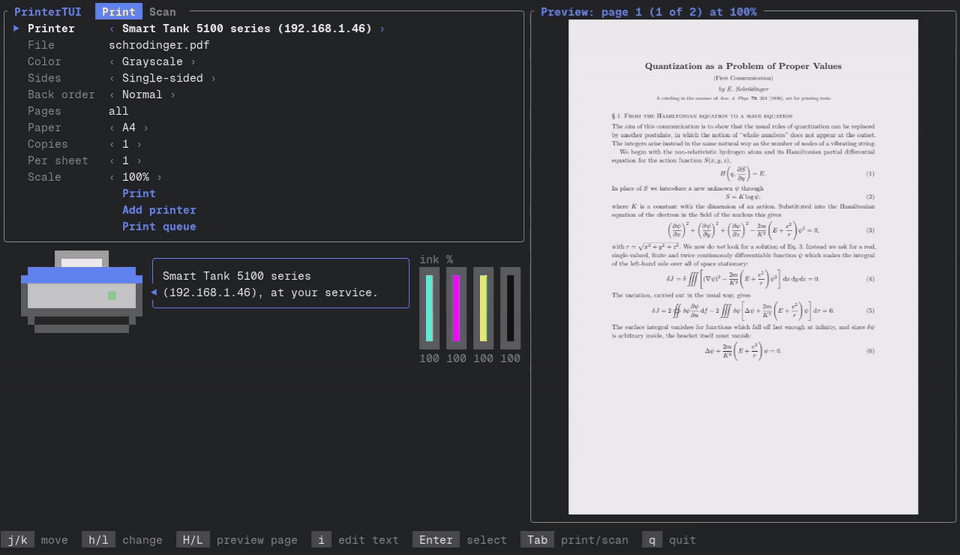

# PrinterTUI

Terminal app to print and scan on Linux, macOS and Windows.

[](docs/demo.mp4)

- Prints PDFs, photos (JPEG, PNG; HEIC and other formats on macOS), text files, and other documents through LibreOffice.
- Preview of the pages as they will print; scale 25-200%, pages per sheet, copies, paper, color, print quality (draft, normal, high).
- Manual double-sided printing for printers without a duplexer, and the printer's own duplexer when it has one.
- Scans from network printers (eSCL) or SANE, from the glass or the document feeder; saves PDF, searchable PDF (read in the app's language) or PNG; copies (scan and print).
- Shows the printer's ink levels and problems (out of paper, jam, offline).
- 10 languages. Settings in `~/.config/printertui/config` (`%APPDATA%\printertui\config` on Windows).

## Install

Arch Linux or macOS:

```sh
curl -fsSL https://raw.githubusercontent.com/s0artak/PrinterTUI/main/install.sh | sh
```

Windows 10/11, in PowerShell:

```powershell
irm https://raw.githubusercontent.com/s0artak/PrinterTUI/main/install.ps1 | iex
```

Run the same command again to update or uninstall (`... | sh -s uninstall` uninstalls directly).

macOS and Windows need nothing else. On Linux the installer adds CUPS. Optional: LibreOffice (other documents), SANE (USB scanners), Tesseract (searchable PDFs on Linux).

Development on Arch: `bash test/dev-setup-arch.sh` (`... fake` also adds a test scanner and a PDF printer; then `sh test/printer-debug.sh` runs it with a scanner that scans an article page). `sh test/installer-preview.sh [fresh|jam|smudge]` runs the installer without changing anything.

## Keys

```sh
printertui [file...]           # open with these files loaded
printertui --scan              # open on the Scan tab
printertui --print [file...]   # print with the saved settings, no interface
printertui --version
printertui --help
```

| Key | Action |
| --- | --- |
| Tab | Print, Scan, Settings |
| `j` / `k`, `gg` / `G` | Move |
| `h` / `l` | Change option (on File: the files that printed) |
| `H` / `L` | Previous / next page in the preview (on to the next file) |
| `i` | Type in File, Pages, Save as or Scan folder (Esc to finish) |
| Enter | Pick files or pages, print, scan, save, copy |
| `q` | Quit |

On the Scan tab's Page row:

| Key | Action |
| --- | --- |
| `r` / `R` | Rotate |
| `f` | Filter (gray, black & white) |
| `x` | Keep or leave out |
| `<` / `>` | Move the page |
| `s` | Scan again (replaces the page) |
| `dd` | Delete |

Discard does not lose anything: with the Scan tab empty, `u` brings the pages back.

Double-sided: with a duplexer the printer prints both sides itself; without one the front pages print, then flip the stack as shown and press Enter. If the back pages come out in reverse, set Back order to Reversed.

One-sided: if the pages stack up last page on top, set Order to Reversed.
